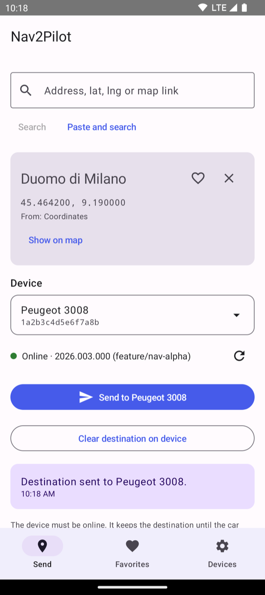
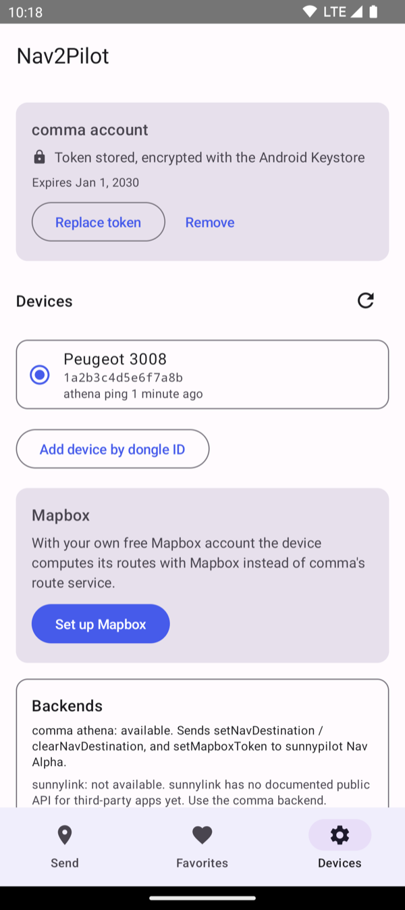
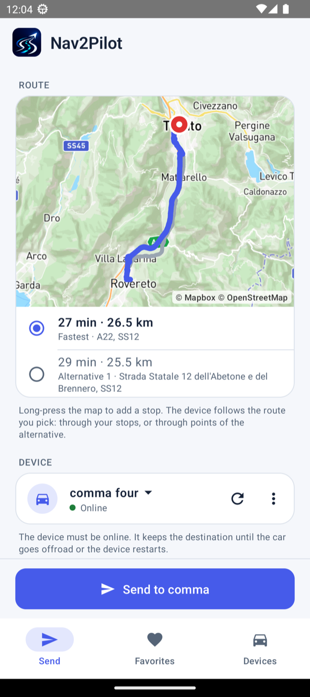
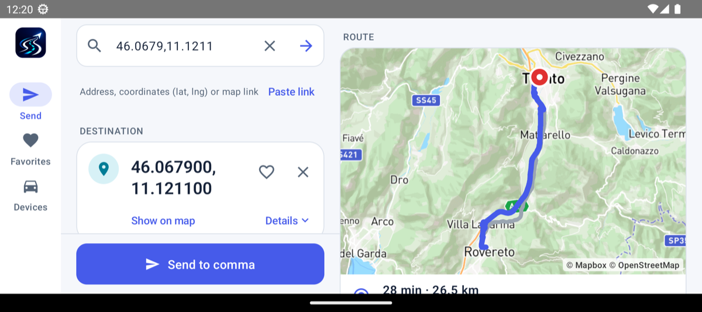

# Nav2Pilot

**Send a destination from your Android phone to your comma device in a couple of taps.**

Find a place in Google Maps, tap **Share → Nav2Pilot**, pick your car, done: the destination shows up on
your comma device running openpilot or sunnypilot with Nav Alpha. No typing on the car screen.

<p align="center">
  
  &nbsp;&nbsp;
  
</p>

## Get the app

To join the **official Google Play tester list** for Android, contact me:

- **Discord:** `cristianku`
- **X:** [@cristianvr75](https://x.com/cristianvr75)
- **Website:** [cristianku.com — Contact](https://cristianku.com/#contact)

Include the **email address of the Google account you use for Google Play**. I'll add that account to the
official tester list and send you the testing link and installation instructions.

On iPhone? [Nav2Pilot for iOS](https://github.com/cristianku/nav2pilot-ios) is in beta on TestFlight: write
to me through [cristianku.com](https://cristianku.com/#contact) with the e-mail address of your Apple ID and I'll add
you as a tester.

## Getting started

1. **Get your comma token.** Open [jwt.comma.ai](https://jwt.comma.ai), sign in with the account your comma
   device is paired to, and copy the token.
2. **Add it to the app.** **Devices → Add token**, paste it, **Verify and save**. Your devices show up in the
   list.
3. **Send a place.** In Google Maps open a place, tap **Share**, choose **Nav2Pilot**, then **Send to …**.
   That's it.

You can also type an address, paste a map link or coordinates in the **Send** tab, and keep your favourite
places one tap away.

## What you need on the car

- openpilot or sunnypilot with **Nav Alpha**, the navigation comma added to openpilot in October 2026. Older
  software doesn't have it, and the app tells you so.
- The comma device must be **online** when you send.
- The car keeps the destination until it goes off-road or the device restarts.

## Optional: your own Mapbox account

Nav Alpha asks comma's route service for the route. In my tests that service refused a device without comma
prime, and the car stayed on "Waiting for route". With your own free Mapbox account the car computes its
route with Mapbox instead.

You can keep official openpilot / sunnypilot and configure `MAPBOX_TOKEN` manually, or install a compatible
build for automatic token transfer. Follow [Configure Mapbox on the comma](#configure-mapbox-on-the-comma)
below. The guide links `cristianku/openpilot:nav-alpha` and `cristianku/openpilot:sunny-nav-alpha`;
the latter is not yet published.

Set it up in **Devices → Mapbox → Set up Mapbox**, the app walks you through it:

1. Create a free Mapbox account. Without a payment card Mapbox only gives you a trial token with low limits;
   with a card you get the free tier, which is plenty for personal use.
2. Copy the **Default public token** (it starts with `pk.`).
3. Paste it in the app. Compatible builds receive it automatically with every destination; official
   software needs the manual setup below.

With the token the Send tab also shows the route on a map, starting from your phone's position (the app asks
for location access the first time). You see the fastest route and up to two alternatives, and you pick the
one the car should drive. Long-press the map to add a stop. The car follows the route you picked; this needs
a build with waypoint support. Other software gets the destination only and picks its own route.

<p align="center">
  
</p>

### Configure Mapbox on the comma

Choose either manual setup on official software or automatic setup with a compatible build. Nav2Pilot
shows both options in its Mapbox settings. It does not connect to the comma over SSH or change startup files.

#### Option 1: keep official openpilot or sunnypilot

This requires a version with **Nav Alpha** that reads `MAPBOX_TOKEN`. Configure your public token on the
comma once; saving it in Nav2Pilot alone does not configure official software.

1. Enable **SSH** in the comma's settings and add your GitHub account with its SSH public key.
   Connect from a computer on the same network, replacing `COMMA_IP` with the device's IP address:

   ```bash
   ssh comma@COMMA_IP
   ```

2. Back up the existing startup file, then edit it:

   ```bash
   cp -p /data/continue.sh /data/continue.sh.nav2pilot-backup
   vi /data/continue.sh
   ```

3. Add the following line **before the command that launches openpilot** (usually
   `exec ./launch_openpilot.sh`). Replace the entire placeholder with your own Mapbox public token.
   Keep the existing directory changes and launch commands; do not replace the whole file:

   ```bash
   export MAPBOX_TOKEN='pk.REPLACE_WITH_YOUR_PUBLIC_TOKEN'
   ```

4. Save the file. Check its shell syntax, and reboot only if the check succeeds, while parked:

   ```bash
   bash -n /data/continue.sh && sudo reboot
   ```

The token reaches navigation at its next startup. Running `export` only in an SSH session does not update
the already running navigation process and does not survive reboot. Keep the token saved in Nav2Pilot too
if you want route previews on the phone.

If you rotate or remove the token, update or delete the export line yourself and reboot. Removing it in
Nav2Pilot cannot remove a token configured in the startup file. This file is outside the openpilot checkout;
a normal code update does not replace it, but reinstalling software can, so check it after a reinstall.

Manual token setup enables Mapbox routing. It does **not** add `setNavRoute`: without that method, the
comma receives the destination only and computes its own route, without the phone's chosen alternatives
or intermediate stops.

#### Option 2: install a compatible build

For automatic token transfer and waypoint support, use the following packaged branches:

| Software | Repository and branch | Custom-software installer URL | Availability |
|----------|-----------------------|-------------------------------|--------------|
| openpilot | [`cristianku/openpilot:nav-alpha`](https://github.com/cristianku/openpilot/tree/nav-alpha) | `installer.comma.ai/cristianku/nav-alpha` | Published |
| sunnypilot | [`cristianku/openpilot:sunny-nav-alpha`](https://github.com/cristianku/openpilot/tree/sunny-nav-alpha) | `installer.comma.ai/cristianku/sunny-nav-alpha` | Not yet published; do not install until available |

Enter the installer URL on the comma's custom-software installation screen. Then save your public token
in **Devices → Mapbox** in Nav2Pilot: the app sends it to the selected comma when saved and before sending
destinations. No manual environment setup is needed for these builds.

## Car screens: CarlinKit, Android Auto, CarPlay

On a landscape screen (a car head unit, a tablet, a phone on its side) the app switches to two panes: search,
destination and the send button on the left, the route map on the right, the tabs in a rail on the side.

<p align="center">
  
</p>

### CarlinKit and other Android boxes: compatible

Nav2Pilot runs on CarlinKit boxes that run Android themselves (the "AI Box" / "Tbox" models), like on a phone,
in the landscape layout above. It does not run on the small CarlinKit adapters that only make CarPlay or
Android Auto wireless: those cannot install apps.

1. Connect the box to the internet (Wi-Fi or your phone's hotspot).
2. Join the [official tester list](#get-the-app) and follow the installation instructions provided for your
   device. Use the Google account you supplied when requesting tester access.
3. Set up the comma account and Mapbox in Devices, as on a phone.

Good to know:

- Android 8.0 or later.
- Address search needs Google Play services on the box. Without them, coordinates and map links still work.
- The route preview starts from the box's position. A box without GPS has no position: the destination can
  still be sent, without the preview.

### Android Auto: not yet

Android Auto does not show ordinary apps: an app has to provide a dedicated car screen, built from the
templates of Google's Android for Cars App Library. Nav2Pilot does not have one yet, so it does not appear in
Android Auto. Until it does, use it on the phone or on a CarlinKit Android box.

When a build with Android Auto support is out, it is not from the Play Store, so Android Auto has to be told
to show it:

1. On the phone, open the Android Auto settings (Settings → Connected devices → Connection preferences →
   Android Auto, or the Android Auto app).
2. Tap **Version** at the bottom about ten times, until it says developer settings are enabled.
3. Menu (⋮) → **Developer settings** → turn on **Unknown sources**.
4. Back in the Android Auto settings → **Customize launcher**: enable Nav2Pilot.

### CarPlay

CarPlay is for the [iOS app](https://github.com/cristianku/nav2pilot-ios) and is not supported yet either: a
CarPlay app needs a dedicated car screen and a CarPlay entitlement that Apple grants on request.

## If something doesn't work

- **"The comma token was rejected (HTTP 401)"**: the token has expired. Get a new one at
  [jwt.comma.ai](https://jwt.comma.ai) and replace it in Devices.
- **"Device unreachable"**: the comma device is offline. Try again when it's on and connected.
- **The car shows "Waiting for route"**: see "Optional: your own Mapbox account" above.
- **The update doesn't install over v1.0 or v1.0.1**: those two builds were signed with a different key.
  Uninstall them once, then install the testing build using the instructions provided when you join the
  tester list.

## Privacy

- Your comma token and your Mapbox token are encrypted with a key that never leaves the Android Keystore,
  and they are never logged.
- The app only talks to comma (to reach your device), to Google Maps (to open shared links), to the phone's
  address search and, if you set it up, to Mapbox. No analytics, no tracking.
- Your position is only used for the route preview: it goes to Mapbox, with your own token, and nowhere else.

Nav2Pilot is an independent project, not affiliated with comma.ai or sunnypilot.

---

## Technical details

Kotlin, Jetpack Compose, Material 3. Package `com.cristianku.nav2pilot`. It only talks to documented network
APIs, independently of the openpilot / sunnypilot source code.

### Features in detail

- Android share target for Google Maps (place name, address and `maps.app.goo.gl` link) and "Open with"
  for `geo:` links.
- Coordinates from full Google Maps URLs, Maps URLs API links (`api=1`), legacy `q=` / `ll=` / `daddr=`
  links, `geo:` URIs and `google.navigation:` URIs. Short links are expanded by following redirects.
- Manual entry: `lat, lng`, a pasted link, or an address search (Android `Geocoder`).
- Several devices: all devices of the comma account, plus devices added by dongle ID.
- Connection status (athena `getVersion`: shows the version and branch running on the device).
- Send and clear the destination, with confirmation or a precise error.
- Favorite destinations.
- comma token stored encrypted with an Android Keystore key.
- **Mapbox (optional)**: your own free Mapbox token, sent to the device so that it asks Mapbox for its routes
  instead of comma's route service (see "Mapbox token on the device").
- **Route map (with the Mapbox token)**: the fastest route and its alternatives from the phone's position,
  stops added with a long press; the picked route goes to the device as waypoints (see "Route map and
  waypoints").
- **Landscape layout** for car head units and tablets: two panes and a navigation rail.

### comma token

The token is checked with `GET /v1/me` before it is stored. If the token carries an `exp` claim the app
shows its expiry date; the token lifetime is not documented in the sources below, so when sending starts
failing with HTTP 401, generate a new token.

### Verified API

Everything Nav2Pilot sends is taken from source code or official documentation:

| What | Source |
|------|--------|
| `POST https://athena.comma.ai/<dongle_id>` with a JSON-RPC 2.0 body is relayed to the device's websocket | <https://api.comma.ai> ("Athena"), [commaai/comma-api `openapi.yaml`](https://github.com/commaai/comma-api/blob/master/openapi.yaml) (`/{dongleId}` on server `https://athena.comma.ai`) |
| Auth header `Authorization: JWT <token>`, tokens from jwt.comma.ai | <https://api.comma.ai> ("Authentication"); openpilot `tools/lib/api.py` |
| API host `https://api.commadotai.com` | openpilot `common/api/comma_connect.py`, `tools/lib/api.py` |
| `GET /v1/me/devices/`: `dongle_id`, `alias`, `device_type`, `last_athena_ping`, `is_owner` | <https://api.comma.ai> ("List devices"), `openapi.yaml` `Device` schema |
| `GET /v1/me` validates a token | openpilot `tools/lib/auth.py` |
| `setNavDestination(latitude: float, longitude: float)` returns `{"success": 1}`, or `{"success": 0, "error": "Invalid destination coordinates"}` out of range | commaai/openpilot `openpilot/system/athena/athenad.py`; sunnypilot `nav-alpha` same file |
| `clearNavDestination()` returns `{"success": 1}` | same file |
| `setMapboxToken(token: str)` returns `{"success": 1}`, or `{"success": 0, "error": ...}` for anything but a public `pk.` token; `""` removes it | cristianku/sunnypilot `nav-alpha` `openpilot/sunnypilot/navd/athena.py`; cristianku/openpilot `nav-alpha` `openpilot/selfdrive/navigation/nav2pilot/athena.py` (not in commaai/openpilot) |
| Both write/remove the `NavDestination` param (JSON `{"latitude", "longitude"}`) that `navd` routes to | `openpilot/selfdrive/navigation/navd.py` |
| `NavDestination` flags `CLEAR_ON_MANAGER_START \| CLEAR_ON_OFFROAD_TRANSITION` | `openpilot/common/params_keys.h`, applied in `openpilot/system/manager/manager.py` |
| JSON-RPC errors: `-32601` method not found, `-32602` invalid params, `-32000` server error | `openpilot/system/athena/rpc.py` |
| `getVersion()` returns `version`, `remote`, `branch`, `commit`, `commit_date` | `openpilot/system/athena/athenad.py` |
| A queued message returns the result string "Device offline, message queued" | <https://api.comma.ai> ("Athena") |

Notes:

- Only `latitude` and `longitude` are sent. The comma-api schema still lists `place_name` and
  `place_details` for `setNavDestination` (the pre-2026 signature), but the current athenad function takes
  exactly two parameters, and the device's dispatcher answers unknown keyword arguments with `-32602`.
- athena's offline queue is documented for "some specific methods"; the schema only lists
  `uploadFilesToUrls` there. Nav2Pilot therefore expects the device to be online and does not set `expiry`.
- athena's HTTP error bodies for unknown or offline devices are not documented; the app shows the HTTP
  status and whatever text the server returns.
- `clearNavDestination` is in the device code but not in the comma-api schema.

#### Google Maps links

- `maps.app.goo.gl` links are expanded one redirect at a time, reading only the `Location` header and
  only on Google hosts. The EU consent interstitial (`consent.google.com/...?continue=<maps url>`) is not
  fetched: its `continue` parameter already contains the Maps URL.
- In expanded place URLs the pin is `!3d<lat>!4d<lng>` inside `data=`. This is **not a documented
  format**, only observed in real redirects; it is preferred over the `@lat,lng,zoom` viewport, which can
  be kilometres away from the place. A viewport-only result is marked approximate.
- When a link has no coordinates, the shared address lines (or the place name) are geocoded.

### Mapbox token on the device

On a device without comma prime (`PrimeType` 0), comma's route service `api.commadotai.com/v1/nav` answered
**HTTP 403** to every route request (route `0000011a`, 2026-10-17): navd got no route and the map stayed on
"Waiting for route". The method `setMapboxToken(token)` stores the user's public token in the `MapboxToken`
param, and navd then asks `api.mapbox.com` directly. It is implemented in these source branches (see the packaged installation options above):

- sunnypilot: [cristianku/sunnypilot `nav-alpha`](https://github.com/cristianku/sunnypilot/tree/nav-alpha) (`sunnypilot/navd/athena.py`)
- openpilot: [cristianku/openpilot `nav-alpha`](https://github.com/cristianku/openpilot/tree/nav-alpha) (`selfdrive/navigation/nav2pilot/athena.py`)

Setup: Devices → Mapbox → **Set up Mapbox**.

1. Create a free Mapbox account (<https://account.mapbox.com/auth/signup/>) and confirm the e-mail.
2. Add a payment card: without one Mapbox gives only a trial token with lower limits; with a card the free
   tiers apply ([Mapbox sign-up guide](https://docs.mapbox.com/accounts/guides/signup/)).
3. Copy the **Default public token** (`pk.…`) from the Tokens page
   (<https://console.mapbox.com/account/access-tokens/>). Secret tokens (`sk.…`) are refused.
4. Paste it and tap **Verify and save**: it is checked with Mapbox's Tokens API
   (`GET https://api.mapbox.com/tokens/v2`, answer `TokenValid`) and stored encrypted like the comma token.

- **With a build supporting `setMapboxToken`:** the app sends the token right after saving (to the selected car) and before every
  destination, silently. The device writes it only when it changed. The `MapboxToken` param survives reboots,
  but `Params::clearAll` deletes it when the device boots a build that does not define it; the next
  destination brings it back.
- **Remove** in the app also sends an empty token to a compatible selected car. It does not remove
  a manually configured `MAPBOX_TOKEN`; that must be removed from the startup file separately.
- A device without `setMapboxToken` (`-32601`, official openpilot / sunnypilot) still receives the destination.
  The app's Mapbox settings link the manual setup guide; token transfer itself is not available on that build.
- The device's map tiles (mapsd) still come from comma (`v1/<dongle_id>/nav/tiles`).

### Route map and waypoints

- Routes: Mapbox Directions API, profile `mapbox/driving-traffic` (the same as the device's navd), from the
  phone's position (platform `LocationManager`, no Google Play services needed) through the stops to the
  destination, with up to two alternatives when there are no stops.
- Map: [osmdroid](https://github.com/osmdroid/osmdroid) with Mapbox Streets raster tiles (Static Tiles API)
  and the user's public token. The Mapbox Maps SDK for Android is not used: it needs a secret token just to
  download it from Mapbox's Maven repository, which every contributor and the CI would need.
- What the device gets: `setNavRoute(latitude, longitude, waypoints)` (cristianku/sunnypilot `nav-alpha`,
  `sunnypilot/navd/athena.py`; cristianku/openpilot `nav-alpha`, `selfdrive/navigation/nav2pilot/athena.py`). Stops go as waypoints with `via: false`; a picked alternative goes as three
  silent `via: true` points at 25 %, 50 % and 75 % of its length, so the device's own Mapbox request follows
  the same roads. The fastest route without stops is sent as `setNavDestination`. A device without
  `setNavRoute` (JSON-RPC -32601) gets `setNavDestination` instead, and the app says so.

### sunnylink

Investigated, **not implemented** (the `SunnylinkTransport` backend is an explicit stub):

- Verified: on the device, `sunnylinkd` imports the same JSON-RPC `dispatcher` as athenad
  (`openpilot/sunnypilot/sunnylink/athena/sunnylinkd.py`), so `setNavDestination` is reachable over the
  sunnylink websocket (`wss://athena.sunnylink.ai`).
- Found: the public [sunnylink frontend](https://github.com/sunnypilot/sunnylink-frontend) ships
  generated types for `POST https://athena.sunnylink.ai/navigation/{deviceId}/set_destination`
  (`latitude`, `longitude`, `place_name`, `place_details`), but no UI uses it and there is no documentation.
- Not available: a documented API contract, and a supported way for a third-party app to obtain a sunnylink
  token (the frontend signs users in through its own Logto OIDC client).

### Architecture

```
app/src/main/java/com/cristianku/nav2pilot/
  MainActivity.kt            share / VIEW intents -> ViewModel
  AppContainer.kt            manual dependency wiring
  model/                     Destination, PairedDevice, validation rules
  parsing/                   URL splitting, coordinates, Google Maps / geo: links, shared text
  resolve/                   short-link expansion, link -> search fallback
  geocode/                   PlaceSearch (Android Geocoder)
  net/                       HttpClient abstraction (HttpURLConnection)
  transport/                 NavigationTransport + comma athena backend + sunnylink stub
  mapbox/                    Mapbox token check
  security/                  Keystore AES-GCM cipher, encrypted token store, JWT expiry
  data/                      favorites and devices (SharedPreferences + JSON)
  ui/                        Compose screens: Send, Favorites, Devices
```

`NavigationTransport` is the backend abstraction (`listDevices`, `checkStatus`, `setDestination`,
`clearDestination`, `setMapboxToken`). Each device records its backend, and `TransportRegistry` picks the implementation, so
another backend can be added without touching the UI.

### Security and privacy

- The comma JWT is encrypted with AES-256-GCM using a non-exportable key in the Android Keystore; only the
  ciphertext is stored, in app-private preferences. Backups and device transfer are disabled.
- The token is never logged (the app has no logging), is excluded from `HttpRequest.toString()`, and is not
  shown again after saving.
- The Mapbox public token is encrypted the same way, and is sent only to `api.mapbox.com` (token check) and,
  through athena, to your own device.
- Network access is limited to `api.commadotai.com`, `athena.comma.ai`, Google Maps hosts (only to expand
  shared links), the phone's Geocoder service (address search) and, only with a Mapbox token,
  `api.mapbox.com`. No analytics.

### Build

Toolchain (pinned on purpose):

- JDK 17 (with `jlink`, e.g. Temurin 17)
- Android SDK platform 36 (Android 16) and build-tools 35.0.0
- Gradle 8.14.3 through the wrapper (distribution SHA-256 pinned), Android Gradle Plugin 8.13.2,
  Kotlin 2.2.21 with its Compose compiler plugin, Compose BOM 2025.12.01
- `targetSdk` 36, as Google Play requires a recent one; `minSdk` 26 (Android 8.0), so the same APK also
  installs on older phones and car boxes. The app draws edge to edge on every Android version.

```
./gradlew testDebugUnitTest lintDebug assembleDebug
# APK: app/build/outputs/apk/debug/app-debug.apk
```

Android Studio opens the project directly. Create `local.properties` with `sdk.dir=/path/to/Android/sdk`
if `ANDROID_HOME` is not set.

Upgrading to a current AGP / compileSdk is a separate step: it needs a newer Gradle, newer SDK packages and
newer AndroidX versions together.

### Tests

- JVM unit tests (`app/src/test`): link parsing (including a real `maps.app.goo.gl` redirect and EU consent
  hop captured on 2026-10-17), short-link expansion, resolver fallbacks, the exact athena JSON-RPC requests
  and response handling, token storage, repositories and the ViewModel flow. No network access.
- Instrumented test (`app/src/androidTest`): Keystore encryption round trip. Needs a device or emulator:
  `./gradlew connectedDebugAndroidTest`.

### CI

`.github/workflows/android.yml` runs only when a `v*` tag is pushed. It runs unit tests and release
lint, builds a signed release APK and the instrumented test APK, and publishes the release APK on
GitHub Releases. Ordinary pushes to `main` do not start a build.

#### Permanent release signing

Every release must use the same private signing key. The old `v1.0` and `v1.0.1` APKs used different
temporary debug keys and cannot update each other. Moving from one of those builds to the permanent
release key requires uninstalling the old app once, which removes its token, devices and favorites.
Subsequent releases signed with the permanent key can update in place.

Configure these repository **Actions secrets** before pushing the next release tag:

| Secret | Value |
| --- | --- |
| `ANDROID_KEYSTORE_BASE64` | Base64 encoding of the permanent release keystore |
| `ANDROID_KEYSTORE_PASSWORD` | Keystore password |
| `ANDROID_KEY_ALIAS` | Signing key alias |
| `ANDROID_KEY_PASSWORD` | Signing key password |

Keep a secure backup of the keystore and passwords. Never generate a new key in CI, commit it to Git,
or replace it between releases. The workflow fails if signing secrets are missing and verifies the
APK signature before uploading it.

For local release builds, put the same signing configuration in an ignored `keystore.properties`
at the repository root:

```properties
storeFile=.signing/nav2pilot-release.keystore
storePassword=YOUR_KEYSTORE_PASSWORD
keyAlias=nav2pilot
keyPassword=YOUR_KEY_PASSWORD
```

Both `*.keystore` and `keystore.properties` are excluded from Git. CI uses the corresponding
`ANDROID_KEYSTORE_PATH`, `ANDROID_KEYSTORE_PASSWORD`, `ANDROID_KEY_ALIAS`, and `ANDROID_KEY_PASSWORD`
environment variables instead.

```sh
./gradlew assembleRelease -PreleaseVersion=1.0.2
# APK: app/build/outputs/apk/release/app-release.apk
```

Tags must be `vMAJOR.MINOR.PATCH` (or `vMAJOR.MINOR`, equivalent to patch zero). The tag supplies
`versionName`; `versionCode` is `MAJOR * 1000000 + MINOR * 1000 + PATCH`, so increasing the version
also increases Android's update number. Minor and patch components must be between 0 and 999 and
the resulting code must be between 1 and 2100000000. Publish versions in increasing order.
Local debug builds without `-PreleaseVersion` keep their development version and do not need
release signing credentials.

## License

MIT, see [LICENSE](LICENSE).
